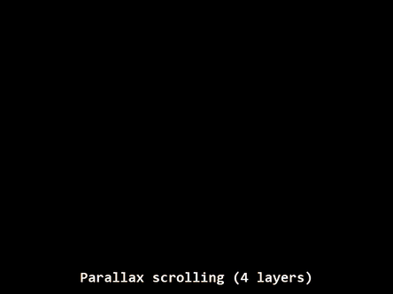
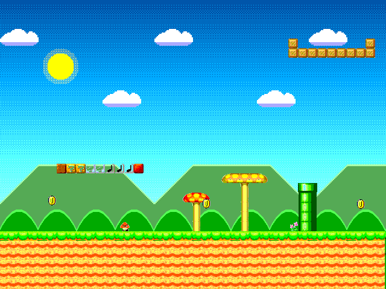
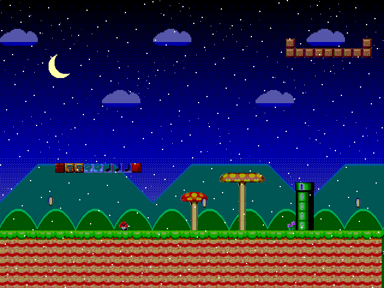

# Background Tile — Project 3

A scrolling tile background in Verilog for the
[Tiny Tapeout VGA Playground](https://vga-playground.com/), modelled on the
background layers of the 8-bit NES and 16-bit SNES picture processors.
640×480 @ 60 Hz, 25 MHz pixel clock, RGB222.

**▶ [Open it in the VGA Playground](https://vga-playground.com/?repo=https://github.com/macint0/vga-bgtile)**

## Demo (20 s)

Recorded from the playground simulation, one frame per simulated frame. It shows
the parallax scroll, running, the wave, mosaic, screen shake, the day/night
fade and snow. Full-resolution 60 fps version:
[docs/bgtile-demo.mp4](docs/bgtile-demo.mp4)

| Day | Night with snow |
| --- | --- |
|  |  |

## Running it

Open the playground link above, then click the gamepad icon under the screen to
use the keyboard as a gamepad.

| Action                  | Gamepad    | Keyboard (gamepad mode) | ui_in switch |
| ----------------------- | ---------- | ----------------------- | ------------ |
| Scroll left / right     | D-pad      | `←` `→`                 | 0 / 1        |
| Run (scroll faster)     | hold B     | hold `b`                |              |
| Auto-scroll on/off      | Start      | `t`                     |              |
| Wave (HDMA wobble)      | A          | `a`                     | 2 (hold)     |
| Mosaic                  | X          | `x`                     | 3 (hold)     |
| Day / night             | Y          | `y`                     |              |
| Screen shake            | Select     | `s`                     |              |
| Snow                    | R          | `r`                     | 7            |

## How it works

**Tiles (the NES/SNES idea).** The screen is not stored as a picture. A
*tilemap* stores one byte per 16×16 cell, and a *tileset* image stores the
pixels of 256 tiles:

- `mariobg256j.mem`: the 256×256 tileset image from the course repo
  (`pongsagon/teach_hw`), 16×16 tiles, 6-bit colour per pixel.
- `map128.mem`: 128×30 tiles = 2048 px wide. Columns 0–79 are the course's
  `map2.mem` level, with its block lettering changed to spell CHULA; columns
  80–127 are new.
  Because the width is a power of two, the camera position simply wraps and
  the level loops forever.

For each pixel, `(x + scroll) / 16` and `y / 16` pick the tilemap cell, the
tile number's high and low nibbles pick the tile's row and column in the
tileset, and `(x + scroll) % 16`, `y % 16` pick the pixel inside the tile:
`tileset[{tile[7:4], y[3:0], tile[3:0], x[3:0]}]`. No multiplier needed.

**Pipeline.** Reading the tilemap takes one clock and reading the tileset
another, so the colour comes out 3 clocks after the pixel's coordinates. The
`hsync`, `vsync` and display-enable signals are delayed by the same 3 clocks
so the picture stays aligned.

**Effects.**

- *Parallax:* white tile pixels are transparent. Behind them are layers that
  scroll at different speeds: near hills at 1/2, far hills at 1/4, clouds at
  1/8 (plus a slow drift), stars at 1/16. The hills are drawn from triangle
  waves and a parabola, so they need no memory.
- *Sky gradient:* key colours change every 128 lines, and an ordered (Bayer)
  dither blends between them, giving a smooth gradient with only 2 bits per
  channel.
- *Wave:* each scanline gets its own horizontal offset from a 32-entry sine
  table — the SNES does this with HDMA.
- *Mosaic:* masking the low bits of x and y makes 2/4/8/16 px blocks, like the
  SNES mosaic register.
- *Fades:* brightness is multiplied by 0–16/16 and the remainder is dithered,
  so fades look smooth. Day/night fades out, swaps palette, fades in.
- *Palette cycling:* ripples move across the pond, ? blocks and coins blink.
- *Sprites:* two Goombas (`kuribo16j.mem`, 2 walk frames) patrol the ground in
  world space and flip to face where they walk; coins (`coinj.mem`, 4 spin
  frames) float and bob.
- *Snow:* one flake per 32×32 cell, placed by a hash of the cell number; the
  cells move down each frame.
